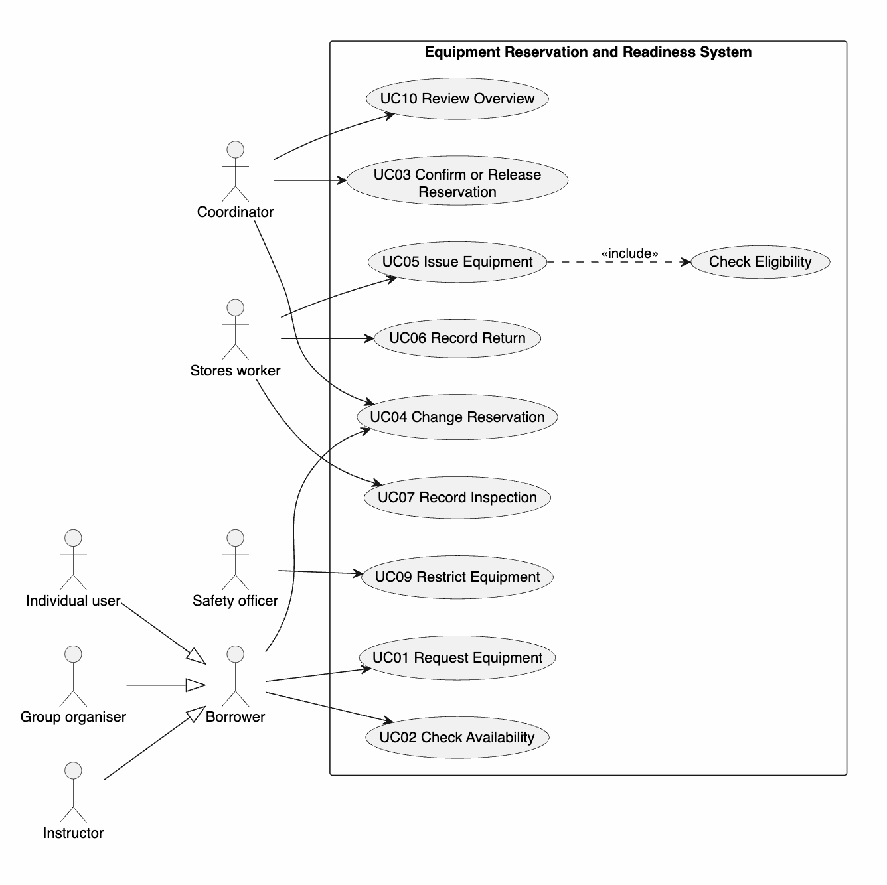

# 4. Use Cases

[PlantUML source](../diagrams/use-case-diagram.puml)

| UC | Actor | Goal | FR |
| --- | --- | --- | --- |
| UC01 | Borrower | Request equipment | [FR01](../requirements/requirements.md#fr01) |
| UC02 | Borrower | Check availability | [FR03](../requirements/requirements.md#fr03) |
| UC03 | Coordinator | Confirm or release provisional reservation | [FR02](../requirements/requirements.md#fr02) |
| UC04 | Borrower, Coordinator | Change reservation | [FR06](../requirements/requirements.md#fr06) |
| UC05 | Stores worker | Issue equipment | [FR04](../requirements/requirements.md#fr04), [FR05](../requirements/requirements.md#fr05) |
| UC06 | Stores worker | Record return | [FR07](../requirements/requirements.md#fr07) |
| UC07 | Stores worker | Record inspection | [FR03](../requirements/requirements.md#fr03) |
| UC09 | Safety officer | Restrict equipment | [FR08](../requirements/requirements.md#fr08) |
| UC10 | Coordinator | Review overview | [FR09](../requirements/requirements.md#fr09) |

"Check Eligibility" is included in UC05 because it always happens.

## Detailed use case: UC05 Issue Equipment
- **Actor:** Stores worker
- **Trigger:** Borrower arrives to collect a confirmed reservation.
- **Precondition:** Reservation is confirmed.
- **Main flow:**
  1. Stores worker selects the reservation.
  2. System shows reserved items and kits.
  3. System checks eligibility evidence (include Check Eligibility).
  4. System confirms each kit is complete and no item is drying, under inspection or restricted.
  5. Stores worker records condition and instructions.
  6. System records items as issued.
- **Alternative:** 4a. Size unsuitable – stores worker swaps for another available item; continue at 4.
- **Exceptions:**
  - 3a. Evidence missing – item is blocked ([BR03](../requirements/rules-and-uncertainty.md#br03)).
  - 4b. Kit incomplete – system names the missing component; kit is blocked ([BR01](../requirements/rules-and-uncertainty.md#br01)).
- **Postcondition:** Items are issued and no longer available to others.
- **Gherkin:** [SC01, SC02](../features/issue-equipment.feature)

---
[← Requirements](../requirements/requirements.md) · [Home](../README.md) · [Next: Domain analysis →](05-domain-analysis.md)