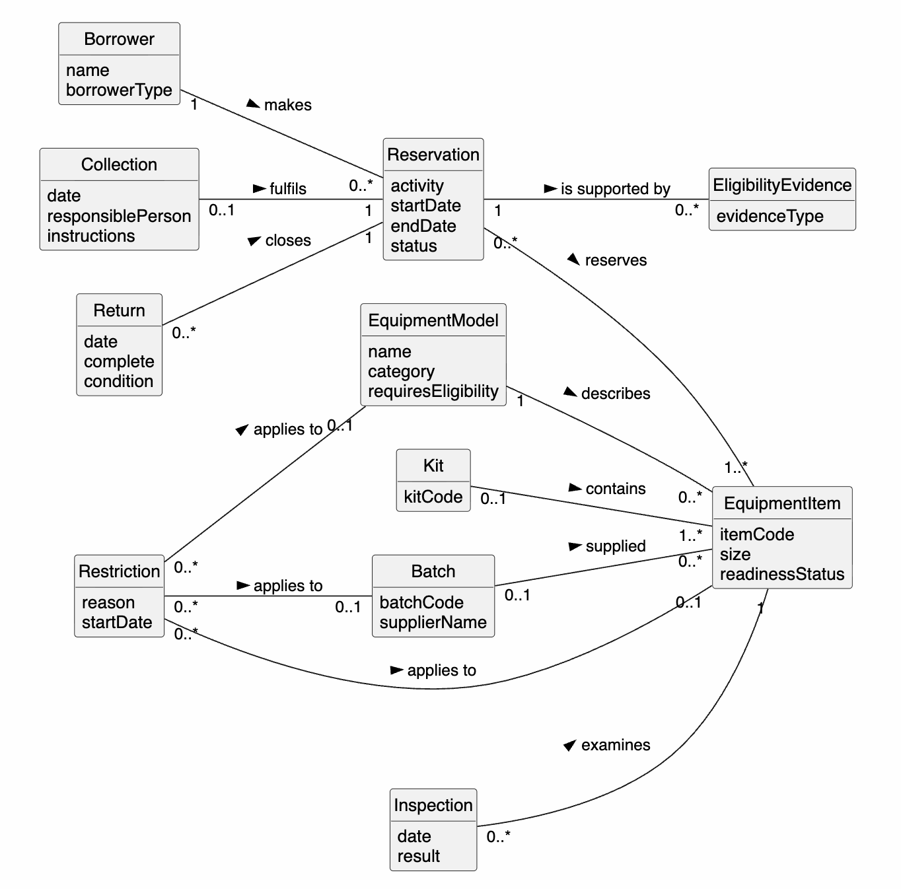

# 5. Domain Analysis

## Candidate concepts
| Candidate | Decision | Reason |
| --- | --- | --- |
| Equipment | Split into EquipmentModel and EquipmentItem | Requests name a model; restrictions hit a model or one item [E] |
| Kit / set | Merge into Kit | Synonyms [E] |
| Component | Merge into EquipmentItem | A component is an item inside a kit |
| Batch | Keep | Restrictions can hit a supplier batch [E] |
| Supplier | Convert to Batch.supplierName | Only needed to identify a batch |
| Request / booking | Merge into Reservation | A request is a provisional reservation (status) |
| User, club, school, instructor | Merge into Borrower (borrowerType) | Same goals |
| Activity, location, season | Convert to Reservation attributes | Describe a reservation |
| Training, supervision, instructor approval | Merge into EligibilityEvidence | [E] "evidence of training, supervision or an approved instructor" |
| Collection, return, inspection | Keep | Real events with their own data [E] |
| Safety notice | Convert to Restriction.reason | A notice causes a restriction |
| Drying, under inspection, reserved | Convert to readinessStatus | States, not things |
| Damage report, size stock | Remove (this release) | No FR covers them now; possible later |
| Coordinator, stores worker, safety officer | Remove | Actors, not domain concepts |
| Spreadsheet, paper form, weather | Remove | Current technology / out of scope |

## Domain model

Restriction links to an item, a model **or** a batch; only one is used each time (BR04).